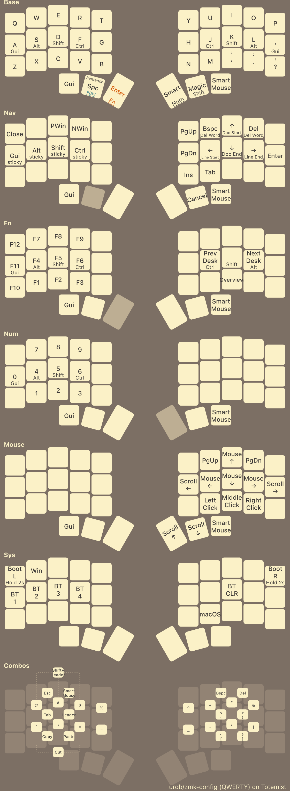

# Totemist: urob QWERTY

Standalone firmware for the 36-key Totemist sold at https://ergomech.store.
This branch, `urob-qwerty`, adapts [urob's keymap](https://github.com/urob/zmk-config)
at `1331b1a` to QWERTY, with Toucan's per-host Mac/Windows controls and maintenance
layer. The bottom-right pinky switch is repaired; `?`/`!` works there normally.



[SVG](docs/keymap.svg) · [diagram data](docs/keymap.yaml)

## What stays urob

The bilateral home-row mods, timings, combos, leader sequences, smart-num,
magic shift, punctuation morphs and the Nav/Fn/Num/Mouse layers remain urob's.
`'` is on the right pinky home key; shifted comma/dot produce `;`/`:`.
The outer thumbs remain Gui and Smart Mouse when used individually.

The deliberate differences are QWERTY alphas, native host shortcuts, and the
maintenance layer below. Sys is the highest layer so it also overrides Mouse;
Fn+Num no longer opens urob's old Sys layer.

## Maintenance: hold both outer thumbs

The two far outer thumbs (positions 30 and 35), pressed within 100 ms and held,
open Sys from any normal layer. Release the chord to leave it. Positions match
the inner 36 keys of the current Toucan keymap:

| Key position on QWERTY | Action |
|---|---|
| Q / P | Hold 2 seconds to bootloader the left / right half |
| W | Select Windows shortcuts for the current host |
| M | Select macOS shortcuts for the current host |
| A / S / D / F | Select Bluetooth profile 1 / 2 / 3 / 4 |
| K | Clear the active Bluetooth profile |

Other Sys keys do nothing, apart from the two inner thumbs being transparent,
as on Toucan. The dongle-only T bootloader hold is intentionally omitted.
Short Q/P presses do nothing. Each half has its own hold timer and preserves
the physical event source, so P targets the right half over the split link.

## Mac / Windows shortcuts

Like Toucan, the selection defaults to macOS and is saved separately for USB
and each Bluetooth profile. Changing hosts restores that host's saved choice;
W/M changes only the currently active host. Allow the settings debounce to
finish before powering off. The reused implementation retains Toucan's source
names and settings format, without its display synchronization.

| Action | macOS | Windows |
|---|---|---|
| Copy / cut / paste combos | Cmd+C / X / V | Ctrl+C / X / V |
| Close (Nav+Q) | Cmd+W | Ctrl+W |
| Previous / next window (Nav+E / R) | Cmd+Shift+grave / Cmd+grave | Alt+Shift+Tab / urob's Alt+Tab swapper |
| Previous / next desktop (Fn+J / L tap) | Ctrl+Left / Right | Win+Ctrl+Left / Right |
| Overview (Fn+comma) | Option+grave (your Toucan host binding) | Win+Tab |
| Long-tap Nav+J / L | Cmd+Left / Right (line start/end) | Home / End |
| Long-tap Nav+I / K | Cmd+Up / Down (document start/end) | Ctrl+Home / End |
| Long-tap Nav+U / O | Option+Backspace / Delete (delete word) | Ctrl+Backspace / Delete |

The short Nav taps remain arrows/backspace/delete. Fn+J/L still hold Ctrl/Alt.
Mac window cycling matches Toucan's current grave shortcuts, not its abandoned
Option+Tab experiment. The two Linux-only pin-across-desktops bindings
(Fn+N/M) are unbound: neither OS has a native equivalent.

Unicode leader sequences automatically select macOS Unicode Hex Input or
Windows WinCompose for the active host before emitting a character. Select
the Unicode Hex Input input source on macOS, or install
[WinCompose](https://github.com/samhocevar/wincompose) on Windows.

## Standalone firmware only

The left half is central; the right half is peripheral. There are no dongle
builds or dongle-display dependencies. Sleep is enabled after 30 minutes idle,
matching urob; a key press wakes the keyboard.

| CI artifact file | Flash to |
|---|---|
| `totem_left-seeeduino_xiao_ble-zmk.uf2` | Left half |
| `totem_right-seeeduino_xiao_ble-zmk.uf2` | Right half |
| `settings_reset-seeeduino_xiao_ble-zmk.uf2` | Either half, only when clearing settings/bonds |

Download the firmware archive from this branch's successful Actions run.
Locally downloaded artifacts are in `firmware/latest/`. If switching from old
dongle firmware, flash settings reset to both halves, then the standalone
left/right images, and re-pair the keyboard.

ZMK and urob's six modules remain on their compatible `v0.3` releases.
The old dongle shield source files are retained but are not built or used.

## Validation and diagrams

Run `python3 tests/run_host_tests.py` for per-host persistence, OS press/release
routing, and bootloader cancellation/source tests. CI builds all three
standalone targets. BLE pairing, wake-up and key feel require hardware testing.

Install [keymap-drawer](https://github.com/caksoylar/keymap-drawer) 0.22.1 and
`librsvg`, then regenerate all three diagram files:

```sh
python3 scripts/draw_keymap.py \
  --include /path/to/zmk-helpers/include \
  --include /path/to/zmk-unicode/include
```

Use the modules' `v0.3` checkouts. Styling and binding labels live in
[docs/keymap-drawer.yaml](docs/keymap-drawer.yaml).
The generated view includes all layers and urob's combos;
the maintenance chord is described above rather than drawn across both halves.
The diagram uses a generic 36-key split outline, not the exact Totemist geometry.

Background: [Miryoku](https://github.com/manna-harbour/miryoku),
[bilateral home-row mods](https://sunaku.github.io/home-row-mods.html),
[urob's layout discussion](https://github.com/urob/zmk-config/discussions/103).
